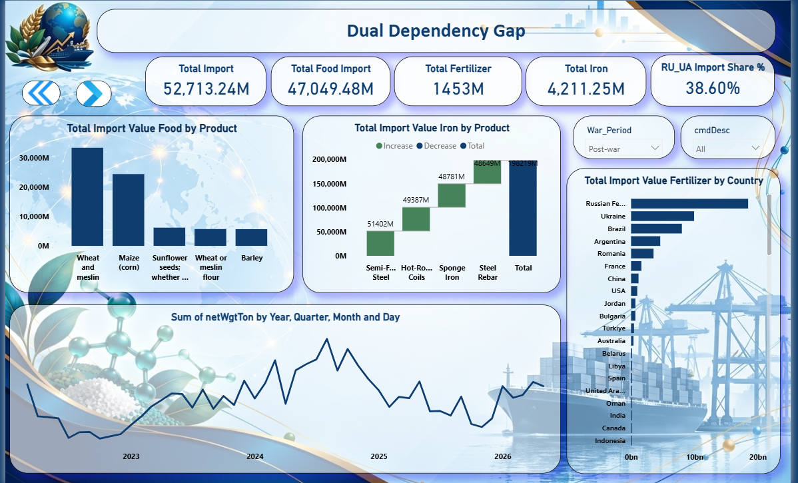
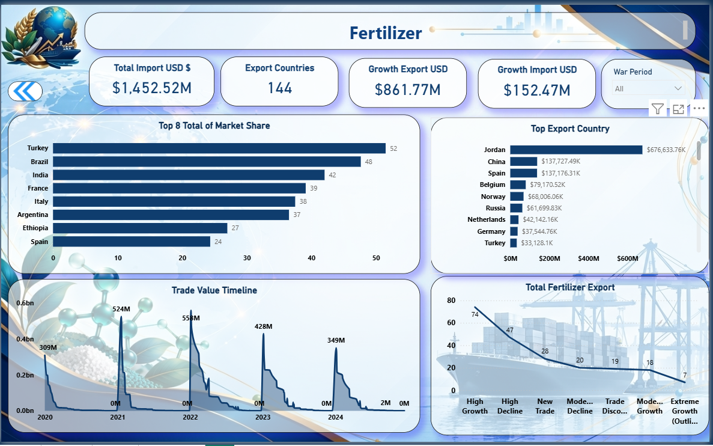

# Dual Dependency Gap

## Analyzing Geopolitical Trade Risks and Forecasting Egypt's Strategic Sectors

### Project Overview

**Dual Dependency Gap** is a graduation project that investigates Egypt's exposure to geopolitical disruptions, with a particular focus on the Russia–Ukraine war and its potential implications for strategic trade sectors.

The project focuses on three key sectors:

- **Food Grains and Agriculture**
- **Fertilizers**
- **Iron and Steel**

It combines trade data analysis, data collection and preparation, Power BI reporting, and machine learning forecasting to explore Egypt's import dependency, historical trade patterns, and potential domestic production scenarios through 2030.

The goal is to provide a data-driven perspective on strategic trade risks and explore how changes in domestic production could affect import dependency and future trade scenarios.

### Project Objectives

- Analyze historical trade patterns across the selected strategic sectors.
- Examine Egypt's import dependency and exposure to international trade disruptions.
- Collect, clean, and prepare data for reliable analysis and forecasting.
- Forecast potential production and import trends through 2030.
- Compare a baseline scenario with a hypothetical scenario involving a 10% increase in domestic production.
- Present findings through data visualizations and reporting to support strategic planning and risk assessment.

### Methodology

The project follows a data-driven workflow:

1. **Data Collection:** Gather relevant historical trade and production data from available sources.
2. **Data Cleaning and Preparation:** Organize datasets, handle data quality issues, and prepare the data for analysis.
3. **Exploratory Analysis:** Examine historical patterns across the selected sectors and identify relevant trade and production trends.
4. **Machine Learning Forecasting:** Evaluate candidate forecasting models and estimate potential outcomes through 2030.
5. **Scenario Analysis:** Compare baseline estimates with a hypothetical 10% increase in domestic production to explore possible changes in import requirements.
6. **Data Visualization:** Use Power BI reporting to communicate findings and make the results easier to interpret.

## Dashboard Preview

  
  

  
  

### Machine Learning Component

The project includes a machine learning component designed to forecast production and import trends through 2030 for agriculture, fertilizers, and iron and steel.

The notebook evaluates candidate models and uses the selected model for each sector. The current model selection is:

- **Agriculture:** Ridge Regression
- **Fertilizers:** Naive Last-Value Model
- **Iron and Steel:** Naive Last-Value Model

The analysis compares a baseline scenario with a hypothetical scenario in which domestic production increases by 10%. This comparison explores potential changes in import requirements and related trade outcomes.

**Important:** These forecasts are estimates based on historical data and modeling assumptions. The scenarios are exploratory and should not be interpreted as guaranteed outcomes or as definitive causal measurements of the Russia–Ukraine war's impact on Egypt.

### Tools and Technologies

- **Python** — data analysis and forecasting
- **Pandas and NumPy** — data manipulation and preparation
- **Scikit-learn** — machine learning model development and evaluation
- **Matplotlib** — data visualization
- **Microsoft Excel** — data organization and preparation
- **Power BI** — interactive reporting and dashboard visualization
- **Power Query and DAX** — data transformation and analytical calculations

### My Contributions

My primary contributions to this team graduation project focused on data preparation and the machine learning component, alongside visual design and dashboard collaboration.

- **Data Collection:** Contributed to collecting and consolidating the data required for the selected sectors.
- **Data Cleaning and Preparation:** Prepared and organized datasets for analysis and forecasting.
- **Machine Learning and Forecasting:** Developed the forecasting component, evaluated candidate models, and conducted scenario analysis through 2030.
- **Visual Design:** Designed the project logo and the dashboard background to support a consistent visual identity.
- **Dashboard Collaboration:** Supported my teammate during dashboard development and contributed to the overall presentation of the project.

### Team Collaboration

This project was developed collaboratively as part of the Data Analytics track. Dashboard visualization and implementation were primarily led by my teammate, while my main responsibilities focused on data collection, data preparation, machine learning forecasting, and visual design support.

### Repository Contents

- `egypt_2030_forecasting_model.ipynb` — machine learning forecasting and scenario analysis through 2030.
- `requirements.txt` — Python dependencies required to run the forecasting notebook.
- `data/` — project data and information about the required input files.

### Data Requirements

The forecasting notebook expects an Excel workbook named `EGYPT_2030_FINAL_ALL_YEARS_MODEL.xlsx`. The workbook must be available in the notebook's execution environment before running the model.

If the input workbook is not included in this repository, it must be provided separately. The notebook may require its file path to be adjusted depending on the execution environment.

### Limitations and Interpretation

- Forecasting results depend on the historical data available and the assumptions used in the models.
- The 10% production increase is a hypothetical scenario, not a confirmed government policy or an observed outcome.
- Forecasts should be interpreted as exploratory estimates rather than guarantees.
- The analysis explores trade exposure and potential implications; it does not, by itself, establish that observed changes were caused exclusively by the Russia–Ukraine war.

### Data Source

Trade data for the broader project was collected from UN Comtrade:

https://comtradeplus.un.org/

### Project Context

A collaborative graduation project developed as part of the Data Analytics track, combining data analytics, machine learning, and business intelligence to explore Egypt's strategic trade dependencies.
